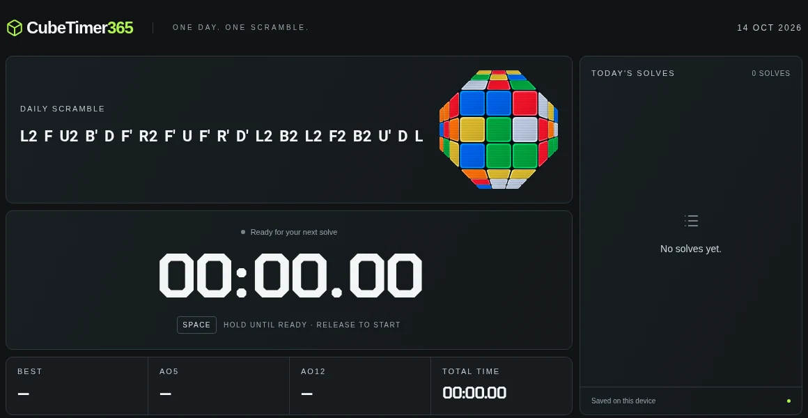

# CubeTimer365

[Open the timer](https://progbeat.dev/cubetimer365/)

A Rubik's Cube timer with one scramble each day. Use the same scramble for all
your solves that day.

The idea is to explore more efficient solutions to the same scramble and practise
the patterns you find through repeated attempts. You can compare attempts from
the same starting position, then try a new scramble the next day.

## Controls

Hold **Space** until **Ready**, then release to start. Press Space again to stop.
On a touchscreen, hold and release the large timer area to start. While solving,
tap anywhere on the page to stop and save.

Release early to cancel the hold. **Escape** cancels the current attempt.

## Features

- A daily 20-move scramble with a cube preview.
- Today's solve history, with individual solve deletion.
- Best time, AO5, AO12 and total solving time.
- A chart of solve times and averages.
- Three cube finishes; click or tap the cube to choose one.

Solves are saved in this browser on this device. Clearing browser data removes
them.

Optional Google Analytics counts visits only after you allow it. Open **Privacy
& analytics** on the site to read the details or change your choice. Solve history
is never sent to Analytics. [Analytics setup and behavior](docs/ANALYTICS.md).

[Development and checks](docs/DEVELOPMENT.md) · [License](LICENSE)
